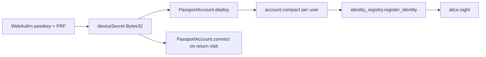

# Midnight Passport (integration)

> **Versions:** every pin in this skill comes from `references/versions.json`, the repo's single source of truth (checked in CI). Resolve the current set at use time with `references/volatile.md`. Never install `@latest`.

Midnight Passport is the **identity + custody** layer: a user creates a passkey, gets a Night ID (`alice.night`), and lands on a **contract-custodied** account without seeing a seed phrase.

This skill teaches agents how to **implement** Passport pieces in an app. For a clone-and-run localnet demo, use `example-passport-dapp/` + `templates/passport-dapp/`.

**What this skill produces:**
- Passkey → 32-byte device secret (PRF) helpers
- `PassportAccount` deploy/connect + custody circuits
- `IdentityRegistry` register / lookup
- Witness private-state pattern (`device_secret`, `grant_secret`, `recovery_secret`)
- Session rules (never persist secrets)

**Runnable code:** `templates/passport-dapp/`  
**Related:** `example-passport-dapp/`, `compact/`, `midnight-js/`, `token-transfers/`, `security/`

**Prototype caveats (do not hide from the user):**
- Auth = **hash-preimage** of device secret (Schnorr / full MIP-0013 arms deferred in this foundations cut)
- Recovery Shamir shares are stored **in public ledger state** — placeholder for PVSS; **do not ship as-is**
- `transientHash` commitments: not guaranteed stable across Compact versions. The 0.31 → 0.36.1 move was checked and produces identical commitments, but re-check before every toolchain upgrade
- One Compact contract **per account**
- Localnet demo funds deposits from a genesis wallet

---

## Workflow

1. Derive device secret (passkey PRF or explicit demo secret)
2. Deploy custody `account` contract with device + recovery commitments (+ Shamir shares)
3. Register handle → account on `identity_registry`
4. Persist **session metadata only** (address, alias, credential id) — re-derive secret on unlock
5. Call custody circuits via `PassportAccount` (`deposit_night`, withdraw, grants, devices, recover)

---

## Architecture



| Piece | Role |
|-------|------|
| Passkey PRF | Hardware-bound device secret; never stored in localStorage |
| `account.compact` | Custody: Night mirror + shielded OZ map; gated by device witness |
| `identity_registry.compact` | Handle → account address map |
| `PassportAccount` | High-level client over midnight-js `deployContract` / `callTx` |
| `IdentityRegistry` | Register + `accountFor(handle)` lookup |

---

## 1) Dependencies (foundations stack, Ledger 9.1)

Pin with the template (`templates/passport-dapp/package.json` and `app/package.json`). Ported to Ledger 9 on 21 Nov 2026: contracts compile with 0.36.1, `npm test` (23 simulator tests) passes, and the Node code and browser app type-check and build. The localnet lifecycle suites have not been re-run on the Ledger 9 stack yet.

```bash
# root (wallet client + node tests)
@midnight-ntwrk/compact-runtime@0.21.0
@midnight-ntwrk/compact-js@3.0.2
@midnightntwrk/ledger-v9@1.0.2
@midnightntwrk/midnight-js-contracts@5.0.2
@midnightntwrk/midnight-js-types@5.0.2
@midnightntwrk/midnight-js-indexer-public-data-provider@5.0.2
@midnightntwrk/midnight-js-http-client-proof-provider@5.0.2
@midnightntwrk/midnight-js-level-private-state-provider@5.0.2
@midnightntwrk/midnight-js-node-zk-config-provider@5.0.2
@midnightntwrk/wallet-sdk-facade@5.0.1 wallet-sdk-shielded@4.0.1 wallet-sdk-unshielded-wallet@4.0.1
@midnightntwrk/wallet-sdk-dust-wallet@5.1.0 wallet-sdk-hd@4.0.0 wallet-sdk-abstractions@3.0.0 wallet-sdk-address-format@4.0.1

# browser app also needs
@midnightntwrk/midnight-js-fetch-zk-config-provider@5.0.2
@midnightntwrk/wallet-sdk-prover-client@2.0.1 @midnightntwrk/zkir-v2@2.2.0   # ?prover=browser path
vite-plugin-wasm vite-plugin-top-level-await
```

Removed in the port: `midnight-js-network-id` (no `setNetworkId`), `ledger-v8`, `@midnight-ntwrk/wallet-api`, `@midnight-ntwrk/zswap`, and the ledger-v8 `ZswapChainState.tryApply` monkeypatch.

Compact sources use `pragma language_version >= 0.28.0;`. Compile with the pinned toolchain (`npm run compile` does this):

```bash
compact compile +0.36.1 contracts/account.compact contracts/managed/account
compact compile +0.36.1 contracts/faucet.compact contracts/managed/faucet
compact compile +0.36.1 contracts/identity_registry.compact contracts/managed/identity_registry
```

Local stack (`infra/docker-compose.yml`): `midnight-node:2.1.101`, `indexer-standalone:4.4.101`, `proof-server:9.0.2`.

---

## 2) Passkey → device secret

Domain-separated PRF salt: `midnight:passport:prf:device:v0`.

**Create** (onboarding) then **get** (PRF is reliable on assertion, not always on create):

```typescript
// From templates/passport-dapp/app/src/lib/passkey.ts — use that file as source of truth

const PRF_SALT = new TextEncoder().encode('midnight:passport:prf:device:v0');

export async function createPasskey(label: string): Promise<{ credentialIdB64: string; label: string }> {
  const cred = (await navigator.credentials.create({
    publicKey: {
      rp: { name: 'MN Passport', id: window.location.hostname === 'localhost' ? 'localhost' : window.location.hostname },
      user: {
        id: await crypto.subtle.digest('SHA-256', new TextEncoder().encode(`midnight:passport:user:v0:${label}`)),
        name: label,
        displayName: label,
      },
      challenge: crypto.getRandomValues(new Uint8Array(32)),
      pubKeyCredParams: [
        { type: 'public-key', alg: -7 },
        { type: 'public-key', alg: -257 },
      ],
      authenticatorSelection: { residentKey: 'required', userVerification: 'required' },
      extensions: { prf: {} } as AuthenticationExtensionsClientInputs,
    },
  })) as PublicKeyCredential | null;
  if (!cred) throw new Error('passkey creation cancelled');
  const ext = cred.getClientExtensionResults() as { prf?: { enabled?: boolean } };
  if (!ext?.prf?.enabled) {
    throw new Error('Authenticator lacks WebAuthn PRF — use platform passkey or PRF-capable key');
  }
  return { credentialIdB64: btoa(String.fromCharCode(...new Uint8Array(cred.rawId))), label };
}

export async function deriveDeviceSecret(credentialIdB64?: string): Promise<Uint8Array> {
  const allowCredentials = credentialIdB64
    ? [{ type: 'public-key' as const, id: Uint8Array.from(atob(credentialIdB64), (c) => c.charCodeAt(0)) }]
    : [];
  const assertion = (await navigator.credentials.get({
    publicKey: {
      challenge: crypto.getRandomValues(new Uint8Array(32)),
      allowCredentials,
      userVerification: 'required',
      extensions: { prf: { eval: { first: PRF_SALT } } } as AuthenticationExtensionsClientInputs,
    },
  })) as PublicKeyCredential | null;
  const result = (assertion?.getClientExtensionResults() as { prf?: { results?: { first?: ArrayBuffer } } })
    ?.prf?.results?.first;
  if (!result) throw new Error('No PRF result');
  const secret = new Uint8Array(result);
  if (secret.length !== 32) throw new Error(`unexpected PRF length ${secret.length}`);
  return secret;
}
```

**Dev / E2E fallback** (never production):

```typescript
export async function deriveDevModeSecret(passphrase: string): Promise<Uint8Array> {
  const digest = await crypto.subtle.digest(
    'SHA-256',
    new TextEncoder().encode(`midnight:passport:devmode:v0:${passphrase}`),
  );
  return new Uint8Array(digest);
}
```

**UX rules:**
- Serve from `http://localhost:5173/` (valid RP id) — IP hosts break passkeys
- Store only `credentialIdB64` + alias in localStorage — **never** the device secret

---

## 3) Commitments and witnesses

Exported pure circuits (client must use the same via `pureCircuits`):

```compact
export pure circuit derive_device_commitment(secret: Bytes<32>): Field {
  return transientHash<[Bytes<32>, Bytes<32>]>(
    [pad(32, "midnight:passport:device:v0"), secret]
  );
}
// grant:  "midnight:passport:grant:v0"
// recovery:"midnight:passport:recovery:v0"
```

TypeScript:

```typescript
import { pureCircuits } from './contract.js'; // managed account module

export function deviceCommitment(secret: Uint8Array): bigint {
  return pureCircuits.derive_device_commitment(secret);
}
```

Witnesses read hex secrets from private state:

```typescript
export interface AccountPrivateState {
  deviceSecretHex: string | null;
  grantSecretHex: string | null;
  recoverySecretHex: string | null;
}

export function makeWitnesses() {
  return {
    device_secret(ctx) {
      return [ctx.privateState, requireHex(ctx.privateState.deviceSecretHex, 'device_secret')];
    },
    grant_secret(ctx) { /* same pattern */ },
    recovery_secret(ctx) { /* same pattern */ },
  };
}
```

Copy full implementations from `templates/passport-dapp/src/wallet/{contract,witnesses,hex,shamir}.ts`.

**Do not use `ownPublicKey()` for auth** — caller identity comes from device secret commitment, not wallet coin keys.

---

## 4) `PassportAccount` client API

Source: `templates/passport-dapp/src/wallet/account.ts`.

```typescript
import { PassportAccount } from './wallet/account.js';

// Deploy (onboarding)
const recoverySecret = crypto.getRandomValues(new Uint8Array(32));
const account = await PassportAccount.deploy(providers, compiledAccountContract, {
  deviceSecret,
  recoverySecret,
});
// account.address — persist in session

// Unlock (return visit)
const account = await PassportAccount.connect(
  providers,
  compiledAccountContract,
  session.accountAddress,
  { deviceSecret }, // re-derived from passkey
);

// Ledger (decodes queryContractState via read.contractState.deserialize({ v9: ContractState }))
const ledger = await account.ledgerState();

// Night custody (color = token color bytes / hex decoded)
await account.depositNight(colorBytes, amountStars);
await account.withdrawNight(colorBytes, amountStars, recipientBytes32);

// Shielded
await account.depositShielded({ nonce, color, value });
await account.withdrawShielded(recipientCoinPk, color, amount);

// Devices / grants / recovery
await account.addDevice(newDeviceSecret);
await account.addGrant(grantSecret, color, cap);
await account.recover(newDeviceSecret, newRecoverySecret); // bumps device_epoch
```

`recover` invalidates all devices/grants via `device_epoch` bump — reconnect with the new device secret afterwards.

---

## 5) Identity registry (Night ID)

Source: `templates/passport-dapp/src/wallet/identity.ts` + `contracts/identity_registry.compact`.

```typescript
import { IdentityRegistry, handleToBytes32 } from './wallet/identity.js';

const registry = await IdentityRegistry.connect(providers, compiledRegistry, registryAddress);

await registry.register('alice', account.address); // stores alice → account bytes32

const addr = await registry.accountFor('alice'); // hex account address or null
```

Handle rules:
- Normalize lowercase / trim
- Max **32 bytes** UTF-8 into `Bytes<32>` (zero-padded)
- Ledger key = `derive_identity_key(handle)` with tag `midnight:passport:id:v0`
- Demo allows re-register; production must gate updates with ownership proofs

UI display: `${alias}.night`.

---

## 6) Onboarding sequence (app)

Exact UI orchestration lives in `templates/passport-dapp/app/src/views/Onboard.tsx`. Algorithm:

```text
1. alias = normalize(userInput)           // e.g. "alice"
2. passkey = createPasskey(`${alias}.night`) OR load saved credential id
3. deviceSecret = deriveDeviceSecret(passkey)
4. recoverySecret = randomBytes32()
5. account = PassportAccount.deploy(accountProviders, compiledAccount, { deviceSecret, recoverySecret })
6. registry.register(alias, account.address)
7. saveSession({ accountAddress, alias, passkey: { credentialIdB64, label }, identityRegistryAddress })
   // NEVER save deviceSecret / recoverySecret
8. On reload: deriveDeviceSecret(passkey) → PassportAccount.connect(...)
```

Guard stale sessions after localnet reset: `queryContractState(accountAddress)` — if null, clear session.

---

## 7) Session persistence

```typescript
export interface Session {
  accountAddress: string;
  alias?: string;
  identityRegistryAddress?: string;
  identityRegistrationTxId?: string;
  passkey?: { credentialIdB64: string; label: string };
  devMode?: boolean;
}
```

See `templates/passport-dapp/app/src/lib/session.ts`.

---

## 8) Contract surface (foundations)

**`account.compact` circuits agents call via `PassportAccount`:**

| Circuit | Purpose |
|---------|---------|
| constructor(deviceCmt, recoveryCmt, share0, share1, share2) | Deploy |
| `deposit_night` / `withdraw_night` | Unshielded Night custody + balance mirror |
| `deposit_shielded` / `withdraw_shielded` | Shielded custody (OZ map) |
| `grant_withdraw_night` / `grant_withdraw_shielded` | Spend under grant |
| `add_device` / `remove_device` | Device set |
| `add_grant` / `revoke_grant` | Scoped grants |
| `recover` | Epoch bump + new device + new recovery shares |

Gated ops bump a `round` counter (replay defence).

**`identity_registry.compact`:** `register_identity(handle, account)`.

Full Compact sources: `templates/passport-dapp/contracts/`.

---

## 9) Provider wiring

The demo uses a localnet genesis wallet: Wallet SDK 2.x `WalletFacade.init` started from `WalletSeeds.fromMasterSeed(...)`. Providers are built with `createLedger9WalletProvider` / `createLedger9MidnightProvider` and carry `config: { networkId, ttlSeconds }` (see `src/node/wallet.ts`, `app/src/lib/providers.ts`). For production dApps:

- Prefer `1am-wallet/` / `dynamic-midnight-wallet/` / `react-wallet-connector/` for user wallets, wired through `@midnightntwrk/midnight-js-dapp-connector-proof-provider` (`references/midnight-session.md`)
- Keep the Passport **custody contract** as the account surface; the wallet only funds and submits
- No indexer patch is needed on Ledger 9 (indexer 4.4.101 handles no-offset queries)
- Proving: a local proof server 9.0.2, the user's wallet, or the browser path (`?prover=browser`), which now uses `@midnightntwrk/zkir-v2` + ledger-v9 generation-10 keys from `srs.midnight.network`

---

## 10) Troubleshooting

| Symptom | Cause | Fix |
|---------|-------|-----|
| Passkey RP / invalid domain | Opened via `127.0.0.1` or LAN IP | Use `http://localhost:5173/` |
| PRF not enabled | Authenticator lacks PRF | Platform passkey or PRF security key; or `deriveDevModeSecret` for local demos only |
| Unlock hangs forever | Session from old localnet | `queryContractState` — if missing, clear session |
| Witness throws missing secret | Connected without device/grant/recovery hex | Pass secrets into `PassportAccount.connect` |
| Invalid Transaction on register | Registry race / duplicate demo write | Retry; check registry address injected by demo script |
| Deposit fails | No Night in funding wallet / wrong color | Ensure faucet/genesis funded; use wallet's Night color bytes |
| Cross-toolchain commitment break | `transientHash` is not guaranteed stable across toolchains | Checked for 0.31 → 0.36.1: same `derive_device_commitment` / `derive_recovery_commitment` output. Re-run that check before each upgrade; plan `persistentHash` for production |
| `Version mismatch: compiled code expects 0.21.0, runtime is 0.16.0` | Old runtime pinned | Use `compact-runtime@0.21.0` with toolchain 0.36.x |
| Old Preview account/session | Preview relaunched as a new chain on 7 Nov 2026 | Clear the session and onboard again |

---

## 11) Agent checklist

- [ ] Copy passkey helpers from template (or import them)
- [ ] Compile `account` + `identity_registry`
- [ ] Implement witnesses over private state hex fields
- [ ] Deploy account with device + recovery commitments
- [ ] Register Night ID; show `.night` in UI
- [ ] Persist session **without** secrets
- [ ] Re-derive device secret on unlock
- [ ] Warn user: foundations demo ≠ production custody / PVSS
- [ ] Point to `example-passport-dapp/` for localnet one-command run

---

## Related skills

| Need | Skill |
|------|-------|
| Full runnable demo | `example-passport-dapp/` |
| Compact language | `compact/` |
| Wallet connect / dust-free | `1am-wallet/`, `dynamic-midnight-wallet/` |
| Providers / deploy | `midnight-js/` |
| Night units / pools | `token-transfers/` |
| Privacy review | `security/` |
